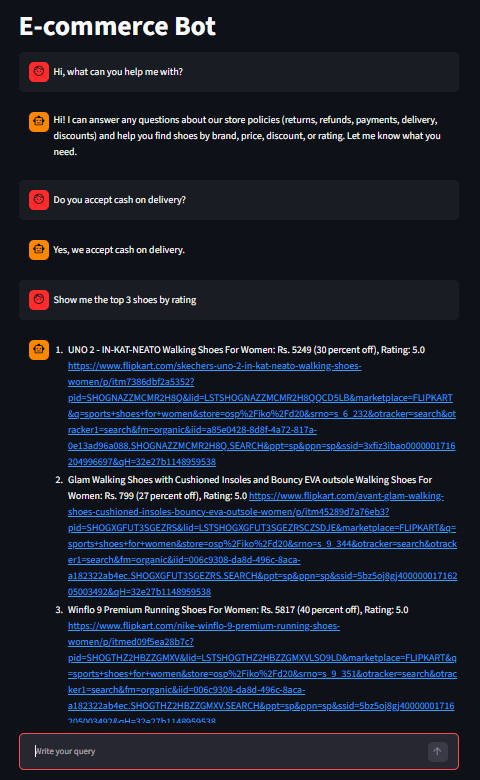

# E-commerce Chatbot: RAG + Text-to-SQL with Semantic Routing

A chatbot for an online shoe store that answers two kinds of customer questions:

- **Policy and FAQ questions** ("What is your return policy?") answered with **RAG** over an FAQ dataset stored in ChromaDB
- **Product questions** ("Show me Puma running shoes under Rs. 3000") answered by having an LLM **write SQL**, running it on a SQLite product database, and turning the results into a natural-language reply

A **semantic router** decides which pipeline each question goes to, using embedding similarity instead of an extra LLM call. Greetings and general chat go to a separate small-talk handler, so they never reach the FAQ or SQL pipelines.

**Live demo:** [Open the app on Streamlit Cloud](https://ecommerce-chatbot-muxdsau4k5rfp4vs3temhq.streamlit.app)

<p align="center">
  
</p>

## How it works

```
User question
     │
     ▼
Semantic router (sentence-transformers embeddings)
     │
     ├── faq ──► ChromaDB similarity search ──► Groq LLM answers from the retrieved FAQs
     │
     ├── sql ──► Groq LLM writes SQL (<SQL> tags) ──► SQLite ──► Groq LLM explains the rows
     │
     └── small_talk ──► Groq LLM with a short assistant prompt replies naturally
```

## Tech stack

- **LLM:** Groq API (`openai/gpt-oss-120b`)
- **Vector database:** ChromaDB
- **Embeddings:** `sentence-transformers/all-MiniLM-L6-v2`
- **Routing:** semantic-router (`IndexedRouter`)
- **Database:** SQLite + pandas
- **UI:** Streamlit chat interface

## Key features

- **Semantic routing:** every question is classified as `faq`, `sql` or `small_talk` by comparing its embedding with example questions for each route, so no extra LLM call is needed to decide.
- **RAG over FAQs:** the closest FAQ entries are retrieved from ChromaDB and the LLM answers only from them, saying it doesn't know when the answer isn't there.
- **Text-to-SQL:** the LLM writes a SQL query inside `<SQL>` tags, which is extracted with a regex and run on the SQLite product database. A second LLM call turns the result rows into a readable list of products with price, discount, rating and link.
- **Safe and efficient queries:** only `SELECT` queries are executed, results are limited to the top rows to stay within the LLM's token limits, and unrelated questions return no SQL at all.
- **Natural small talk:** greetings and general questions get short, friendly LLM replies that explain what the assistant can help with.
- **Chat interface:** a Streamlit chat UI that keeps the conversation on screen using session state.

## Project structure

```
app/
├── main.py         # Streamlit chat UI and routing logic
├── router.py       # semantic routes and example utterances
├── FAQ.py          # FAQ ingestion into ChromaDB + RAG answer chain
├── sql.py          # text-to-SQL chain and result comprehension
├── small_talk.py   # LLM replies for greetings and general chat
├── db.sqlite       # product database
└── resources/
    └── faq_data.csv
```

## Run it locally

1. Clone the repo, create a Python 3.11 virtual environment and install the requirements:
   ```
   python -m venv venv
   venv\Scripts\activate        # Windows (macOS/Linux: source venv/bin/activate)
   pip install -r requirements.txt
   ```
2. Create a `.env` file in the project folder:
   ```
   GROQ_API_KEY=your_key_here
   GROQ_MODEL=openai/gpt-oss-120b
   ```
3. Start the app from the project folder:
   ```
   streamlit run app/main.py
   ```

## Example questions

| Route | Question |
|---|---|
| FAQ | What is the return policy for defective products? |
| FAQ | Do you accept cash on delivery? |
| SQL | Show me the top 3 shoes by rating |
| SQL | Are there any Nike shoes with more than 30% discount? |
| Small talk | Hi, who are you? |
| Small talk | How can you help me? |

## Next steps

- Turn the router into an AI agent that chooses between the FAQ and SQL tools itself
- Add conversation memory so follow-up questions work
- Add an evaluation set to measure routing and answer accuracy
